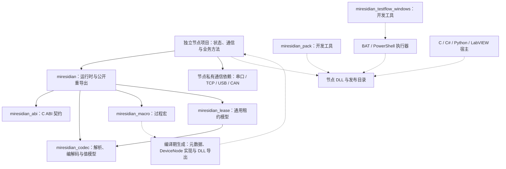
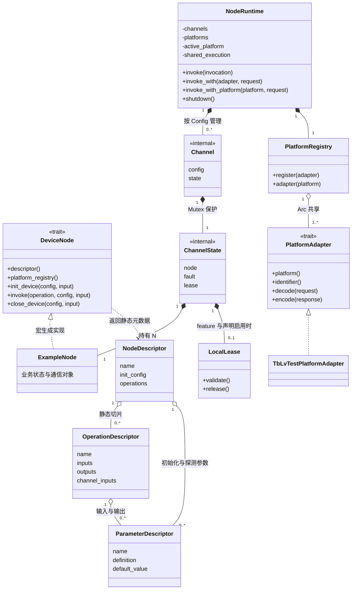
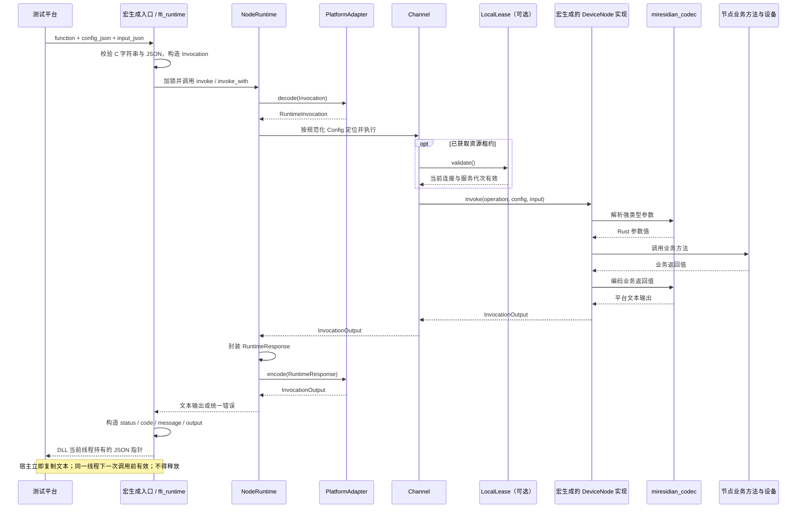

# 架构总览

[文档中心](README.md) · [项目首页](../README.md)

本文从依赖、核心类型和调用过程三个角度描述当前实现。图表使用 Mermaid，支持 Mermaid 的 Markdown 阅读器可直接渲染；纯文本环境可结合下方职责表和源码链接阅读。图表是人工维护的设计视图，省略辅助类型和次要方法；精确字段、泛型约束和签名以链接的源码及 Rustdoc 为准。

## crate 与节点边界

实线箭头表示框架库的直接 Cargo 依赖；虚线表示编译期生成或构建、交付关系，不表示节点 DLL 的运行时依赖。

框架工作区包含五个库 crate 和两个 Cargo 开发工具；节点与烟测夹具是独立 Cargo 项目。`miresidian_macro` 在编译期运行，生成代码调用 `miresidian` 的公开 API，宏实现本身不进入 DLL 的运行时。开发工具通过构建产物或 C ABI 工作，也不进入节点 DLL 的运行时依赖图。

根 crate 始终依赖租约 crate 的通用模型；`lease` feature 控制的是 `miresidian_lease/local-ipc` 与运行时的租约接入。只有启用 feature 且声明租约的节点才走租约路径。平台适配器和 ABI 支撑位于根 crate，具体通信依赖保留在独立节点项目。

依赖定义见[根 Cargo.toml](../Cargo.toml)与[租约 Cargo.toml](../lease/Cargo.toml)；接入步骤见[宏驱动开发](宏驱动开发.md)和[租约说明](../lease/README.md)。

## 核心类型关系（UML）

图中 `NodeRuntime`、`Channel`、`ChannelState` 省略泛型参数，它们实际承载同一节点类型 `N: DeviceNode`。`ExampleNode` 表示任意由宏适配的业务节点，并非框架内置类型。

`<|..` 表示 trait 实现，`*--` 表示对象持有，`o--` 表示共享引用或静态描述关联，`..>` 表示使用关系。`Channel` 与 `ChannelState` 是内部实现类型，不属于公开 Rust API。

运行时以规范化后的业务 Config 定位通道，框架保留配置不进入通道键。每个通道将节点状态与故障标记放在同一把锁中；业务 panic 使该通道进入仅可清理的状态。清理先关闭并析构节点，再释放租约。共享调用的分发策略由 `ExecutionMode` 决定，具体槽位与错误规则见[平台调用契约](platform-contract.md)。

类型定义：[DeviceNode](../src/runtime/node.rs)、[NodeRuntime](../src/runtime/lifecycle.rs)、[Channel / ChannelState](../src/runtime/lifecycle/channel.rs)、[描述信息](../src/runtime/descriptor.rs)、[平台注册表与适配器](../src/platform.rs)、[LocalLease](../lease/src/local_ipc/client.rs)。

## 一次业务调用的时序

下图展示已初始化通道上的成功调用。`miresidian_invoke_with` 额外选择已注册的平台；默认入口通过运行时配置选择平台。两者在适配完成后进入同一调度链。

图中将通道查找与调度合并为一步；版本和元数据查询由运行时直接处理，不创建或调用设备节点。共享调用在适配器中转为结构化槽位，再由运行时分派到多个通道。错误和 panic 路径的状态、稳定代码与恢复规则见 [C ABI](c-abi.md)，租约失效处理见[租约说明](../lease/README.md)。

## 职责与源码位置

| 层次或目录 | 职责 | 主要入口 |
| --- | --- | --- |
| 根 `src/` | 公开入口与重导出 | [lib.rs](../src/lib.rs) |
| `src/runtime/` | 调用与描述模型、通道生命周期 | [contract.rs](../src/runtime/contract.rs)、[descriptor.rs](../src/runtime/descriptor.rs)、[lifecycle.rs](../src/runtime/lifecycle.rs) |
| `src/runtime/lifecycle/` | 单通道隔离与清理、平台选择和配置解析 | [channel.rs](../src/runtime/lifecycle/channel.rs)、[routing.rs](../src/runtime/lifecycle/routing.rs) |
| `src/runtime/shared.rs` | 多通道参数校验、顺序/并行/广播分发 | [shared.rs](../src/runtime/shared.rs) |
| `src/platform/` | 平台专有输入输出映射 | [platform.rs](../src/platform.rs)、[TB 兼容适配器](../src/platform/tb_lv_test_platform.rs) |
| `src/interop/` | C 字符串与 JSON 边界、异常兜底、响应内存 | [ffi_runtime.rs](../src/interop/ffi_runtime.rs) |
| `abi/` | C ABI 常量、类型与唯一公共头文件 | [lib.rs](../abi/src/lib.rs)、[miresidian.h](../abi/api/miresidian.h) |
| `codec/` | 值模型、统一错误、参数与编解码 | [lib.rs](../codec/src/lib.rs) |
| `macro/` | 属性宏入口、节点声明与生成编排 | [lib.rs](../macro/src/lib.rs)、[node.rs](../macro/src/node.rs)、[node_impl.rs](../macro/src/node_impl.rs) |
| `macro/src/node_impl/` | 标注校验、命名、描述、分发与 FFI 生成 | [definition.rs](../macro/src/node_impl/definition.rs)、[naming.rs](../macro/src/node_impl/naming.rs)、[descriptor.rs](../macro/src/node_impl/descriptor.rs)、[dispatch.rs](../macro/src/node_impl/dispatch.rs)、[ffi.rs](../macro/src/node_impl/ffi.rs) |
| `lease/` | 设备无关租约模型与可选本地 IPC | [lib.rs](../lease/src/lib.rs)、[local_ipc.rs](../lease/src/local_ipc.rs) |
| `tools/` | 发布打包、Windows 流程执行及版本检查 | [打包说明](../tools/miresidian-pack/README.md)、[TestFlow 说明](../tools/miresidian-testflow-windows/README.md)、[check_versions.py](../tools/check_versions.py) |
| `tools/fixtures/smoke-node/` | 独立的工具链集成夹具 | [节点源码](../tools/fixtures/smoke-node/src/lib.rs) |
| `tests/` 与各 crate 的测试 | 跨 crate 契约、宏编译诊断与功能回归 | [根集成测试目录](../tests)、[宏测试](../macro/tests)、[编解码测试](../codec/tests) |
| 独立节点项目 | 设备状态、私有通信依赖、业务操作、节点测试与交付说明 | [宏驱动开发](宏驱动开发.md) |

源码使用新式 Rust 模块结构，不使用 `mod.rs`。入口文件负责声明与导出；同一概念具有多个协作职责时采用 `概念.rs + 概念/`，完整规则见[编码规范](coding-standards.md)。

修改时先按上表定位归属：节点标注与生成改 `macro/`，通用编解码改 `codec/`，平台协议映射改适配器，生命周期与共享调度改运行时，设备协议留在独立节点。涉及依赖、核心类型或调用链变化时同步更新本页。
