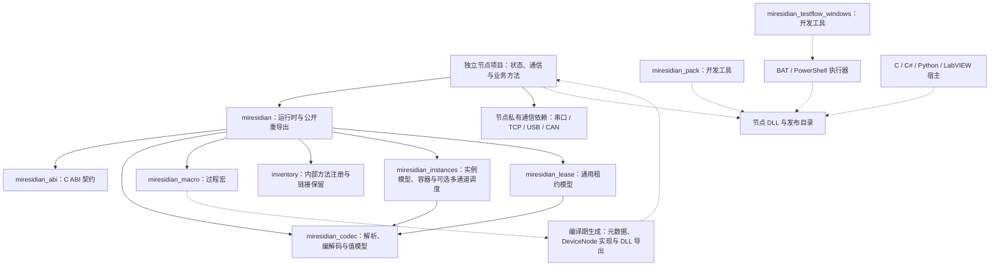
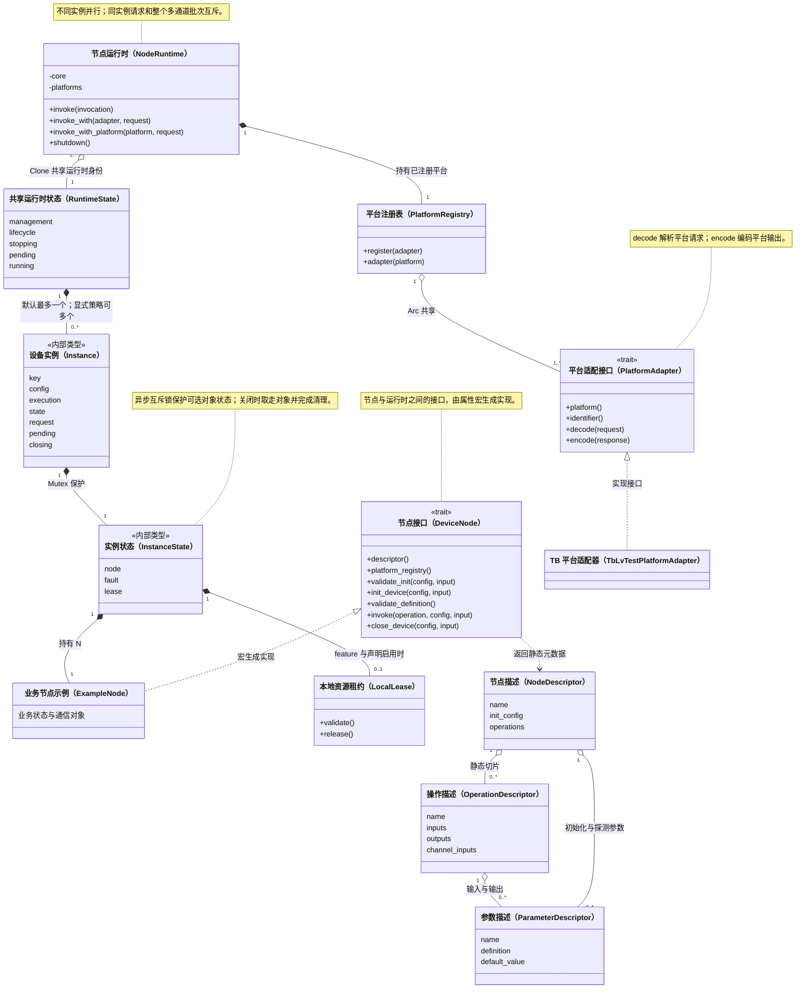
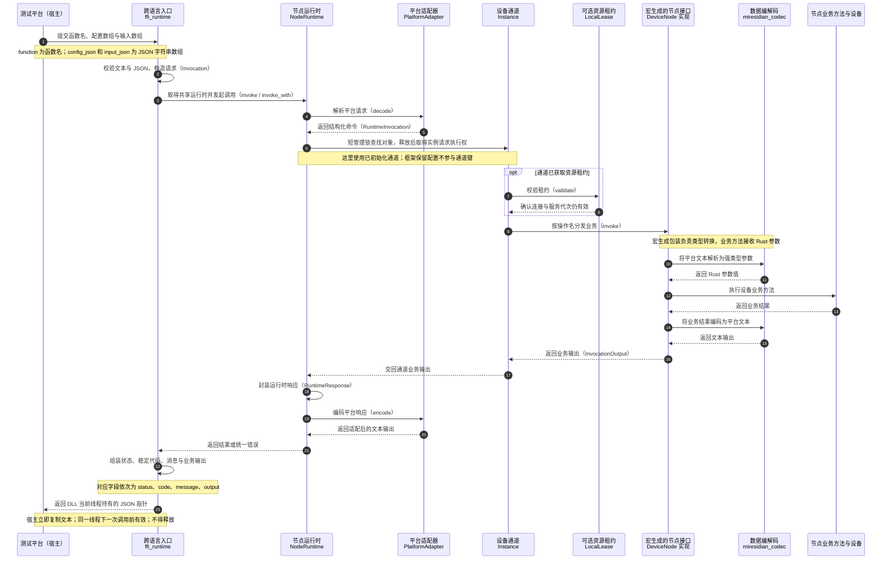

# 架构总览

[文档中心](README.md) · [项目首页](../README.md)

本文从依赖、核心类型和调用过程三个角度描述当前实现。图表使用 Mermaid，支持 Mermaid 的 Markdown 阅读器可直接渲染；纯文本环境可结合下方职责表和源码链接阅读。图表是人工维护的设计视图，省略辅助类型和次要方法；精确字段、泛型约束和签名以链接的源码及 Rustdoc 为准。图中使用中文说明职责，括号内保留源码标识符，便于搜索定位。

## crate 与节点边界

实线箭头表示框架库的直接 Cargo 依赖；虚线表示编译期生成或构建、交付关系，不表示节点 DLL 的运行时依赖。

框架工作区包含六个库 crate 和两个 Cargo 开发工具；节点与烟测夹具是独立 Cargo 项目。`miresidian_macro` 在编译期运行，生成代码调用 `miresidian` 的公开 API，宏实现本身不进入 DLL 的运行时。开发工具通过构建产物或 C ABI 工作，也不进入节点 DLL 的运行时依赖图。

`instances` feature 与同名宏配置共同控制实例策略和多通道执行；未标注节点在任意 feature 组合下仍是单实例。根 crate 始终依赖独立 miresidian_instances 的通用模型及单实例容器，instances feature 开启其 runtime 后端；多实例容器和通用调度留在该 crate，根框架只适配节点生命周期。详见[实例管理](instances.md)。

根 crate 始终依赖租约 crate 的通用模型；`lease` feature 控制的是 `miresidian_lease/local-ipc` 与运行时的租约接入。只有启用 feature 且声明租约的节点才走租约路径。平台适配器和 ABI 支撑位于根 crate，具体通信依赖保留在独立节点项目。

依赖定义见[根 Cargo.toml](../Cargo.toml)与[租约 Cargo.toml](../lease/Cargo.toml)；接入步骤见[宏驱动开发](宏驱动开发.md)和[租约说明](../lease/README.md)。

## 核心类型关系（UML）

图中 `NodeRuntime`、`Instance`、`InstanceState` 省略泛型参数，它们实际承载同一节点类型 `N: DeviceNode`。`ExampleNode` 表示任意由宏适配的业务节点，并非框架内置类型。

`+` 表示公开成员，`-` 表示私有成员；`trait` 表示 Rust 接口。关系中的 `1` 表示一个，`0..1` 表示可选，`0..*` 表示零到多个，`1..*` 表示至少一个。

`<|..` 表示 trait 实现，`*--` 表示对象持有，`o--` 表示共享引用或静态描述关联，`..>` 表示使用关系。`Instance` 与 `InstanceState` 是内部实现类型，不属于公开 Rust API。

### 图中成员的中文含义

方法和字段保留实际源码名称，下表补充中文对照；它们是职责摘要，完整参数与返回类型以源码为准。

| 所属类型 | 成员名称与含义 |
| --- | --- |
| 节点接口 `DeviceNode` | `descriptor` 查询节点描述；`platform_registry` 获取平台注册表；`init_device` 构造已初始化节点并返回业务输出；`validate_definition` 校验注册契约；`invoke` 执行业务操作；`close_device` 关闭设备 |
| 运行时 `NodeRuntime` | `core` 共享运行时状态；`platforms` 平台注册表；管理状态保存 objects 与 active_platform |
| 运行时调用方法 | `invoke` 按配置选择平台并调用；`invoke_with` 使用指定适配器调用；`invoke_with_platform` 按平台编号调用；`shutdown` 关闭全部通道 |
| 对象 `Instance` / `InstanceState` | `key` 关联键；`config` 已保存业务配置；`execution` 对象执行方式；`state` 加锁状态；`node` 业务对象；`fault` 故障原因；`lease` 可选租约 |
| 租约 `LocalLease` | `validate` 校验连接及服务代次；`release` 释放租约与配置锁 |
| 平台注册与适配 | `register` 注册适配器；`adapter` 按平台查找适配器；`platform` 平台编号；`identifier` 文本标识；`decode` 解析请求；`encode` 编码响应 |
| 节点与操作描述 | `name` 名称；`init_config` 初始化配置；`operations` 操作清单；`inputs` 输入参数；`outputs` 输出参数；`channel_inputs` 共享调用使用的输入参数 |
| 参数描述 | `definition` 原样发布的描述文本；`default_value` 可选默认值 |

运行时默认只保留一个对象；instances 策略支持按业务 Config[0] 或 Handle 定位多个对象。Config[0] 是新节点的首个业务配置主键，空主键初始化跳过。框架字段不进入业务配置。每个通道将节点状态与故障标记放在同一把锁中；业务 panic 使该通道进入仅可清理的状态。清理先关闭并析构节点，再释放租约。多通道调用同样以唯一一份 Config 定位一个对象，平台各通道输入均使用该对象；执行方式保存在各自对象上。`ExecutionMode` 只决定这些输入的调度方式，同一对象始终互斥执行；输入位置不关联对象创建顺序。具体输入与错误规则见[平台调用契约](c-abi.md#平台调用契约)。

类型定义：[DeviceNode](../src/runtime/node.rs)、[NodeRuntime](../src/runtime/lifecycle/service.rs)、[Instance / InstanceState](../src/runtime/lifecycle/instance.rs)、[描述信息](../src/runtime/descriptor.rs)、[平台注册表与适配器](../src/platform.rs)、[LocalLease](../lease/src/local_ipc/client.rs)。

## 节点创建与方法汇总

`node` 保留在结构体上，生成节点身份、同模块方法的类型绑定、DeviceNode 实现和唯一 C ABI 入口；`operation` 独立生成方法描述与包装，再提交注册项。每个节点模块只有一个具体节点，可以有多个固有 impl；未标注的方法不会进入平台契约。方法按源码位置稳定排序，首次请求校验重复和保留名称。

初始化不再依赖 Default：解析配置并取得租约后，调用关联构造函数，成功得到节点与业务输出后才登记通道。构造失败由构造函数内部回滚；节点已返回后，输出编码或租约校验失败由框架关闭并析构，再释放租约。端口探测是独立关联函数，不创建临时节点。普通业务调用、共享策略与 C ABI 仍遵循原有契约。

## 一次业务调用的时序

下图按编号展示已初始化通道上的成功调用：先解析请求与选择通道，再执行业务，最后编码响应。`miresidian_invoke_with` 额外选择已注册的平台；默认入口通过运行时配置选择平台。两者在适配完成后进入同一调度链。

图中将通道查找与调度合并为一步；版本和元数据查询由运行时直接处理，不创建或调用设备节点。共享调用在适配器中保留唯一一份 Config 并解析各平台通道输入，运行时先按节点策略从 Config[0] 或 Handle 定位一个对象，再将所有有效输入分派给该对象。错误和 panic 路径的状态、稳定代码与恢复规则见 [C ABI](c-abi.md)，租约失效处理见[租约说明](../lease/README.md)。

## 职责与源码位置

| 层次或目录 | 职责 | 主要入口 |
| --- | --- | --- |
| 根 `src/` | 公开入口与重导出 | [lib.rs](../src/lib.rs) |
| `src/runtime/` | 调用与描述模型、通道生命周期 | [contract.rs](../src/runtime/contract.rs)、[descriptor.rs](../src/runtime/descriptor.rs)、[service.rs](../src/runtime/lifecycle/service.rs) |
| `src/runtime/lifecycle/` | 单通道隔离与清理、平台选择和配置解析 | [instance.rs](../src/runtime/lifecycle/instance.rs)、[routing.rs](../src/runtime/lifecycle/routing.rs) |
| `instances/` | 通用实例策略、单/多实例容器和通用多通道调度 | [lib.rs](../instances/src/lib.rs) |
| `src/runtime/multi_channel.rs` | 同一对象的平台多通道输入校验与顺序/并行/广播调度 | [multi_channel.rs](../src/runtime/multi_channel.rs) |
| `src/platform/` | 平台专有输入输出映射 | [platform.rs](../src/platform.rs)、[TB 兼容适配器](../src/platform/tb_lv_test_platform.rs) |
| `src/interop/` | C 字符串与 JSON 边界、异常兜底、响应内存 | [ffi_runtime.rs](../src/interop/ffi_runtime.rs) |
| `abi/` | C ABI 常量、类型与唯一公共头文件 | [lib.rs](../abi/src/lib.rs)、[miresidian.h](../abi/api/miresidian.h) |
| `codec/` | 值模型、统一错误、参数与编解码 | [lib.rs](../codec/src/lib.rs) |
| `macro/` | 属性宏入口、节点声明与逐方法生成 | [lib.rs](../macro/src/lib.rs)、[node.rs](../macro/src/node.rs)、[operation.rs](../macro/src/operation.rs) |
| `macro/src/operation/` 与 `macro/src/node/` | 方法标注校验、描述及调用包装；节点注册绑定与 FFI | [definition.rs](../macro/src/operation/definition.rs)、[dispatch.rs](../macro/src/operation/dispatch.rs)、[generate.rs](../macro/src/node/generate.rs)、[ffi.rs](../macro/src/node/ffi.rs) |
| `lease/` | 设备无关租约模型与可选本地 IPC | [lib.rs](../lease/src/lib.rs)、[local_ipc.rs](../lease/src/local_ipc.rs) |
| `tools/` | 发布打包、Windows 流程执行及版本检查 | [打包说明](../tools/miresidian-pack/README.md)、[TestFlow 说明](../tools/miresidian-testflow-windows/README.md)、[check_versions.py](../tools/check_versions.py) |
| `tools/fixtures/smoke-node/` | 独立的工具链集成夹具 | [节点源码](../tools/fixtures/smoke-node/src/lib.rs) |
| `tests/` 与各 crate 的测试 | 跨 crate 契约、宏编译诊断与功能回归 | [根集成测试目录](../tests)、[宏诊断测试](../tests/macro_compile_fail.rs)、[编解码测试](../codec/tests) |
| 独立节点项目 | 设备状态、私有通信依赖、业务操作、节点测试与交付说明 | [宏驱动开发](宏驱动开发.md) |

源码使用新式 Rust 模块结构，不使用 `mod.rs`。入口文件负责声明与导出；同一概念具有多个协作职责时采用 `概念.rs + 概念/`，完整规则见[编码规范](coding-standards.md)。

修改时先按上表定位归属：节点标注与生成改 `macro/`，通用编解码改 `codec/`，平台协议映射改适配器，生命周期与共享调度改运行时，设备协议留在独立节点。涉及依赖、核心类型或调用链变化时同步更新本页。

## 并行与异步执行

0.15.0 的 `NodeRuntime` 使用共享内部状态；Clone 共享同一个实例登记表、平台绑定和并发限额。
宏生成的两个同步 DLL 入口共用一个 OnceLock 运行时，不再以全局 Mutex 包围完整调用。
管理锁只保护登记和查找；生命周期事务单独协调；实例请求门禁保护整个请求；状态锁保护业务对象与故障状态。

| 范围 | 执行规则 |
| --- | --- |
| 不同实例 | 可并行业务执行，受运行时并发预算限制 |
| 相同实例 | 请求互斥，多通道批次不可被其他请求插入 |
| 静态查询 | 不等待业务或生命周期事务 |
| 同步业务 | Tokio 阻塞池执行，最多 32 个阻塞线程 |
| 原生 async 业务 | 直接轮询 Future，挂起不占阻塞线程 |
| 初始化、关闭、探测 | 独立生命周期执行器，最多 4 个阻塞线程；当前同一运行时生命周期事务串行 |

默认 `ExecutionLimits` 为 running=32、pending=1024、pending_per_instance=64、batch=256。
pending 包含已开始和等待的请求，满容量直接返回错误；实例等待执行权时不占 running 预算。
实例请求门禁和全局运行预算使用 FIFO 异步信号量/互斥锁；生命周期和业务池分离，避免关闭等待业务时耗尽业务工作线程。
Parallel 多通道输入使用有界批次内的 Future 调度；每项仍通过状态锁，且全部已开始项结束后才返回错误。
独立 instances crate 的通用同步 Parallel 分发最多 32 个工作线程。

`invoke` 等同步 API 阻塞等待最终结果；`invoke_async`、`invoke_platform_async`、`invoke_command_async` 和 `invoke_batch_async` 供异步调用方等待。
宿主原生异步线程应使用 async API。同步 API 在多线程 Tokio 环境通过 blocking bridge 兼容，在单线程异步执行器中返回能力错误。
调用方丢弃等待 Future，不会中断已接收的框架请求；框架内部任务继续持有执行权直至安全结束。

`TaskService` 是有容量上限的任务所有者，提供 submit、submit_batch、poll、wait、cancel、release 和 shutdown / shutdown_async。
提交创建单调不复用的任务 ID；完成结果保留到显式释放，同样占容量；释放运行中任务会失败。
查询与等待可跨线程进行。等待超时仅返回当前快照，不取消任务。快照含 queued/running/cancelling/succeeded/failed/cancelled/timed_out 状态、取消请求标志、错误和输出。

`CallContext` 的截止时间从提交开始，涵盖排队。等待实例或执行预算时取消/到期可直接退出，不执行业务。
业务已经开始后采用协作取消，框架不强杀线程、不丢弃业务 Future、不提前关闭资源。
方法应将剩余时间传给 I/O 或检查 context；忽略取消的方法仍可返回成功，快照会保留取消请求标志。
初始化完成后若已取消或过期，构造对象先清理再返回错误，不登记对象。

关闭保持主键占位，拒绝新业务，等待在途请求后关闭/析构对象，再释放租约。
全局关闭包含已进入构造的初始化；业务 panic 隔离到对应实例，框架请求异常触发运行时清理。
显式关闭任务服务后，使用 `shutdown_executor` 等待并回收执行器线程；有在途请求时拒绝执行器关闭。
DLL 宿主必须在最终卸载前停止并发入口调用并完成清理。租约服务在 Windows 固定承载模块的已有约定仍然适用。

执行器依赖选用 Tokio 1.53.3 LTS（MIT，MSRV 1.71，支持 Linux/Windows），锁定在 1.53 补丁系列；futures-util 用于安全组合与捕获 Future panic。
依据 [Tokio 支持策略](https://docs.rs/crate/tokio/1.53.3) 与 [RUSTSEC-2026-0386 修复范围](https://rustsec.org/advisories/RUSTSEC-2026-0386.html) 选择已修复版本；本项目 MSRV 保持 1.89。

并发测试采用开始/释放信号证明真实执行重叠，覆盖两个 DLL 入口、共享批次、关闭、初始化与全局关闭竞争、容量限制、排队取消、截止时间、原生异步 panic 及跨线程结果回收。

## 后续演进计划

本节记录已确认、但尚未进入当前发布版本的工程化事项。

### 国际化发布信息

- 提交说明优先使用中文。
- 公开发布前，为 README、CHANGELOG 和 Release Notes 提供中英文版本。
- 若未来建设文档站点，再根据浏览器语言自动选择中文或英文页面；Git 提交信息与 Git 托管平台页面不支持自动切换。

### 节点流程测试工具

- `miresidian_testflow_windows` 将 `.testflow` 生成自包含 Windows BAT；流程解析、DLL C ABI 调用、返回格式化和自动 CloseDevice 均由框架内嵌执行器负责。
- 当 `.testflow` 的跨平台语法、断言和报告格式稳定后，再抽取 `miresidian_testflow` 核心 crate；届时 Windows BAT 执行器只保留平台加载职责。
- 工具应通过 C ABI 的 `GetFunctions` 与 `GetInitConfig` 自适应节点，而不包含串口业务规则。
- 保留节点项目对流程文件、测试数据和硬件环境的所有权。

当前 C ABI 保持 v7；异步任务及显式跨实例批次现阶段通过 Rust API 使用。新增外部异步入口需独立评审并提升 ABI。

0.15.1 为根运行时增加可释放的承载模块加载引用：启动业务池及生命周期池之前获取引用；回收全部工作线程后才释放引用。Windows 使用 FROM_ADDRESS 获取引用，不使用不可逆 PIN；Unix 用 dladdr 和 RTLD_NOLOAD 持有既有映射，不使用 NODELETE。主程序静态链接场景不增加动态库引用。

宿主在任何入口调用期间仍须持有自己的加载引用。宿主释放自身引用时，框架引用保护存活工作线程；Rust 嵌入调用方排空任务、关闭实例并调用 shutdown_executor 后，框架额外引用可以释放。关闭同时检查两池的在途工作及外部执行器引用，任意池仍忙时两池都保持原状；线程回收期间阻止重建。

C ABI v7 的现有同步接口保持参数、返回方式和文本内存契约。它不提供最终执行器关闭操作，因此 C 宿主释放句柄不保证立即卸载，空闲执行器可能将模块保持至进程退出。其他加载引用、线程局部析构以及租约服务的既有 Windows PIN 仍可延后实际卸载。外部异步任务接口属于可选扩展，本次没有加入。

加载器边界依据 [Windows GetModuleHandleExW](https://learn.microsoft.com/en-us/windows/win32/api/libloaderapi/nf-libloaderapi-getmodulehandleexw)、[FreeLibrary](https://learn.microsoft.com/en-us/windows/win32/api/libloaderapi/nf-libloaderapi-freelibrary) 和 [dlopen/dlclose](https://man7.org/linux/man-pages/man3/dlopen.3.html)；通过 libc 复用平台声明，不自行定义 Unix ABI。测试夹具 module_lifetime 的私有 probe 导出只用于原生加载器测试，不属于节点公共 C ABI。

本轮 Linux Debug DLL 验证使用两个各等待 30ms 的模拟请求，5 次采样中位数：同步同实例 61.78ms、不同实例 30.96ms；async 同实例 64.08ms、不同实例 32.40ms。该观测仅说明示例的执行重叠，实际设备性能需另测。
