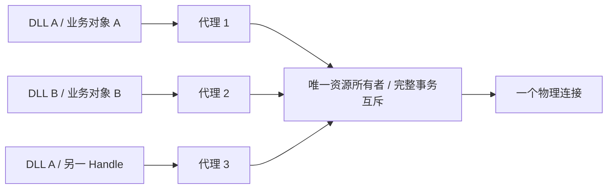

# 跨 DLL/进程共享物理资源

[文档中心](README.md) · [实例管理](instances.md) · [配置租约](../features/lease/README.md)

本文对应框架 0.25.1、lease 0.17.1 提供 `miresidian::lease::shared::{SharedResource, ResourceHandler}`，启用根 feature `lease` 后可用。独立节点使用前核对所需版本已在 crates.io 发布，再升级精确依赖并重新构建；旧 DLL 不会自动获得共享能力。

框架 0.30.2 / lease 0.17.4 修复 Windows 首次并发启动租约服务的同名管道竞争：原生错误 5 后仅在实际连接成功时复用，失败保留原错误。无需业务参数或协议迁移；升级至已发布的修复版本后重新构建 DLL。该首次连接处理不改变失效会话禁止重连/重放的规则。

## 现有 lease 标签自动共享节点资源

框架 0.25.0 的 Lease 模式不再只登记配置：运行时将整个节点资源对象置于唯一所有者，后续 DLL 持有代理，不再执行自己的初始化。原有 init_device 内部可以继续直接打开设备。完整业务操作作为一次代理事务执行，最后引用才执行节点 close_device、析构和释放所有者租约；非最后 CloseDevice 仅释放当前代理。

这是节点资源对象的引用计数，业务状态也共用。共享要求资源键、配置租约字节、节点名称/接口、全部规范化业务 Config 与初始化 Input 文本一致。Handle、DLL 文件名、Rust 类型路径和项目版本不参与身份。不同接口拒绝附着；lease(ignore) 不允许不同初始化状态混入同一节点对象。构造、输出编码失败会回滚；panic 使所有引用停止调用，全部关闭后重建。复用同一本地对象不增加引用。

Direct 模式保持独立构造。只有两端都升级并重建后，旧标签才获得自动共享行为；旧 DLL 不会自动改变。以下精确依赖示例采用前须核实 registry 可用；独立节点不使用本地覆盖。

最后一次显式关闭的 Input 传给所有者 close_device，返回其完整错误类别；异常断连使用空 Input 尽力关闭。已失效引用仍可释放，最后物理资源的关闭与析构先于配置锁释放。代理故障不回退直连、不重连、不重放。

调用有截止时间时传递给代理及远端执行上下文，远端按本机 UTC 时间预算扣除排队耗时；本机时钟调整可能影响该预算。无截止时间等待实际完成。提交后取消不会通过 IPC 强行终止业务，设备仍需自身超时；所有者进程退出会使旧代理失效，须关闭后显式初始化。

使用现有宏标签、直接 open 的两份原生动态库验证：

```bash
cargo build -p miresidian --example leased_resource_dll --example leased_other_dll --features lease,instance --locked
python3 tools/verify_leased_node_dll.py target/debug/examples/libleased_resource_dll.so target/debug/examples/libleased_other_dll.so
```

Windows 替换为相同架构的 Python 和 DLL 路径。该验证实际加载原名、改名和独立编译模块，覆盖并发初始化、一次打开、共享状态、事务互斥、首个引用退出后继续调用、最后关闭后新配置重开及异步/错误保真。独占文件替代硬件端口；它不等同现场 COM5 实测。

下文的通信层模式用于不同节点类型或独立业务状态：每个节点保留自己的对象，只共享物理连接。不要同时让节点自动共享其本身，又在同一资源下嵌套建立通信提供者；两者事务协议不同，会明确冲突。

## 两种身份和生命周期

本地对象的 Config/Handle 定位与复用由[实例管理](instances.md)定义。通信层模式保留各业务对象的独立状态，自动节点 Lease 则共享整个节点；下面的连接代理生命周期与本地对象生命周期分开计数。

资源代理按通信层约定的物理资源键定位一个资源所有者。每个业务对象可持有自己的代理；所有者只打开一次物理连接，并对完整通信事务互斥。释放一个代理不影响其他代理，最后代理退出后才析构连接。



LocalLease 单独使用时仍只协调配置。节点 lease 标注自 0.25.0 自动共享整个节点对象；需要独立业务对象时，通信层使用 SharedResource 工厂和事务入口。

## 通信提供者的共同契约

不同项目共用资源前，明确资源键规范、配置编码和事务协议三项共同契约。框架只传递有界字节，不自动识别设备、端口别名或仪器型号。例如同一串口可约定 serial:COM5，配置完整包含波特率、数据位、校验、停止位和流控；读取超时或设备站号是否属于连接配置，由提供者按真实兼容性决定。事务协议版本独立于配置租约 v2 和资源代理 v2。

独立通信提供者直接由 SharedResource 管理配置租约，不再为同一资源声明自动节点 lease。迁移旧配置编码时，可用 LeaseRequest::from_parameters 构造请求；数值等先用原类型 NodeInput::normalize_text 生成规范文本，字段名和顺序参与编码，不能假设任意 JSON/文本与宏编码相同。

## 通信层接入

1. 所有项目采用同一个资源键规范，如规范化后的 `serial:COM5`。DLL 文件名、项目名和 Handle 不参与物理资源键；别名、大小写和地址规范化归通信提供者。
2. 采用同一个连接配置编码和事务线协议版本。配置描述物理连接兼容性；每次调用的读取超时、设备地址或命令等可作为事务输入。不同字段名、顺序或配置文本不会自动视为等价。
3. 调用 `SharedResource::acquire(resource, configuration, protocol, create)`。工厂只在取得唯一所有权的一方执行；应在工厂内部打开连接，返回实现 ResourceHandler 的资源对象。工厂返回前失败时仍须通过所有权或回滚释放已取得的资源。
4. `ResourceHandler::transact(&mut self, request)` 在所有者中执行。通信层自行编码/解码事务字节，负责设备协议、设备 I/O 超时和清理；可以使用实现相同签名的 FnMut 闭包。节点业务协议与业务状态仍归各项目。
5. 节点的操作通过代理 `transact(request, timeout)` 提交完整事务。查询须把发送、等待和接收放在同一事务，分成两个代理调用不会跨调用保留事务锁。
6. 节点关闭时释放或析构自己的代理。最后使用者退出时，所有者先析构物理连接，再释放其配置租约。业务节点不能直接关闭其他代理使用的底层连接。

独立通信层由 SharedResource 持有租约，不为同一资源重复声明自动节点 lease；否则节点代理和通信提供者协议冲突。框架的 Lease/Direct 选择器控制自动节点共享与本地构造；它不会改写业务通信提供者内部显式使用的 SharedResource。需要在共享与直连间选择时，通信层根据明确的业务 Config 分支，或固定采用其中一条路径；不能在协议不兼容或代理失败时静默回退直连。

SharedResource 是同步接口；原生 async 方法应通过阻塞线程桥执行并等待实际完成，避免阻塞异步工作线程。设备 I/O、事务协议及取消边界仍归通信提供者。

已有对象的访问路径和执行策略切换限制见[实例管理](instances.md#实例身份与物理资源身份)。

## 最小可运行示例：模拟通信提供者

以下程序只模拟连接和事务计数，不访问串口。放入独立程序的 src/main.rs，依赖使用 `miresidian = { version = "=0.25.1", features = ["lease"] }`，然后运行 cargo run。它验证工厂执行一次、两个代理共用所有者，以及释放一个代理不影响另一个；真实设备仍需实现相应的连接与收发。

```rust
use miresidian::lease::{
    LeaseConfiguration, LeaseError, ResourceKey,
    shared::{ResourceHandler, SharedResource},
};
use std::{
    sync::{Arc, atomic::{AtomicUsize, Ordering}},
    time::Duration,
};

fn open_simulated(
    opens: Arc<AtomicUsize>,
) -> Result<impl ResourceHandler, LeaseError> {
    opens.fetch_add(1, Ordering::SeqCst);
    let mut transactions = 0;
    Ok(move |request: &[u8]| {
        if request != b"query" {
            return Err(LeaseError::LocalIpc("unknown simulated request".into()));
        }
        transactions += 1;
        Ok(transactions.to_string().into_bytes())
    })
}

fn main() -> Result<(), Box<dyn std::error::Error>> {
    let resource = ResourceKey::new(format!("simulated-provider:{}", std::process::id()))?;
    let configuration = LeaseConfiguration::new(b"counter-config/1".to_vec())?;
    let opens = Arc::new(AtomicUsize::new(0));
    let mut first = SharedResource::acquire(
        resource.clone(), configuration.clone(), "counter-transactions/1",
        || open_simulated(opens.clone()),
    )?;
    let mut second = SharedResource::acquire(
        resource, configuration, "counter-transactions/1",
        || open_simulated(opens.clone()),
    )?;
    let timeout = Duration::from_secs(1);
    assert_eq!(first.transact(b"query", timeout)?, b"1");
    assert_eq!(second.transact(b"query", timeout)?, b"2");
    first.close()?;
    assert_eq!(second.transact(b"query", timeout)?, b"3");
    assert_eq!(opens.load(Ordering::SeqCst), 1);
    second.close()?;
    println!("shared provider example passed");
    Ok(())
}
```

真实提供者应在工厂中打开串口等资源，由返回的 ResourceHandler 持有句柄并在析构时关闭；将协议解析、设备超时和完整请求—响应放入 transact。节点业务对象只保存代理及自身状态，不自行获取或复制所有者的物理句柄。

## 服务与失败边界

资源代理采用独立线协议 v2，按用户与资源键选择本地端点，Windows 使用命名管道，Unix 使用本地域套接字。所有者通过持久文件的独占锁选举；锁覆盖监听、物理连接及在途事务，文件位于临时目录 `miresidian-resource-v2/<用户摘要>/<资源摘要>.owner`，运行中不得删除或替换。

代理与所有者各持有配置租约。关闭、断连与初始化失败按资源先释放、配置租约后释放的顺序处理。所有者模块在 Windows 和 Unix 上保留加载引用至进程退出，使原 DLL 的宿主引用释放后资源回调仍可执行。

代理单次请求和响应上限均为 16 MiB，握手等待上限 5 秒。事务排队和收发等待由调用者指定，配置租约校验有独立的 2 秒请求截止时间，设备 I/O 仍须自身超时。已发送请求超时或断连后旧代理永久失效，不自动重连或重放；未发送前的参数错误和本地排队超时不损坏会话。已提交的操作可能仍在执行，不能把请求超时解释为设备动作已取消。所有者在完成在途事务、释放最后会话前继续保护物理资源及配置。

设备返回的普通事务错误可由调用方处理后继续调用；处理器 panic 会使该所有者故障，全部会话应关闭后重新初始化。所有者进程退出会使旧代理失效；操作系统回收其物理句柄，其他节点须显式关闭旧代理后再初始化。

代理协议不提供部署身份认证；沿用本地 IPC 的用户环境与访问控制边界。使用不同事务协议的项目不能直接共享一个资源所有者，应统一通信提供者协议。

## 可执行验证

框架内两个动态库示例使用独占文件句柄模拟设备，分别具有不同节点类型和业务计数。它们不属于独立子节点，不采用框架本地覆盖依赖。

```bash
cargo test -p miresidian_lease --features local-ipc --locked --test shared_resource
cargo build -p miresidian --example shared_resource_dll --example other_resource_dll --features lease,instance --locked
python3 tools/verify_shared_resource_dll.py target/debug/examples/libshared_resource_dll.so target/debug/examples/libother_resource_dll.so
```

Windows 使用对应架构的 Python 和 `.dll` 路径。验证包括原名/改名 DLL、独立节点类型、不同 Handle、同 Config 对象复用、独立业务状态、一次打开/最后关闭及完整事务不交错。多进程回归另含所有者退出、超时不重放和工厂失败。

这些证据验证代理及生命周期；实际串口打开、仪器响应和目标宿主加载仍需在接入该通信层的节点上验证。现有带 lease 标注的节点须升级到已发布框架版本并重建 DLL，才能获得自动节点共享；仅复制/改名旧 DLL 不会改变行为。不同业务对象共享连接则仍须接入通信层代理。

资源代理 v2 的关闭帧增加有界请求，最后会话的处理器关闭响应返回给调用方。升级前停止全部 v1 资源代理客户端与所有者，避免两代独立所有者锁并存。配置租约 v2 与 C ABI v7 不变。

0.25.1/lease 0.17.1 仅补齐在线文档构建与精确版本入口，资源行为与 0.25.0/lease 0.17.0 一致。docs.rs 对 lease 启用全部 features，不改变用户的默认依赖能力。精确 API 见 [SharedResource](https://docs.rs/miresidian_lease/0.17.1/miresidian_lease/shared/struct.SharedResource.html) 和 [ResourceHandler](https://docs.rs/miresidian_lease/0.17.1/miresidian_lease/shared/trait.ResourceHandler.html)，文档生成状态须与 registry 可用性分别核实。
